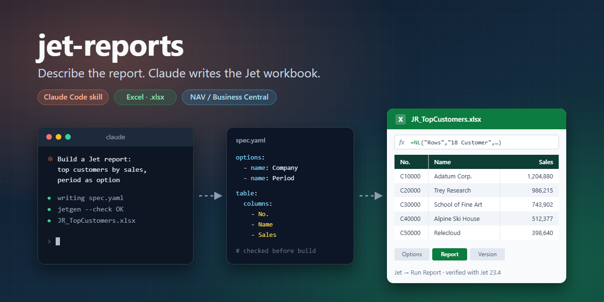

<p align="center">
  
</p>

<p align="center">
  
  
  
  
</p>

<p align="center">
  <b>Build Jet Reports workbooks by describing them.</b><br>
  A Claude Code skill that turns a request into a checked, ready-to-run Excel report for<br>
  Microsoft Dynamics NAV / Business Central – Report Options, NL/NF formulas, version log included.
</p>

---

## Why

Jet reports are powerful, but building them means clicking through the Function Wizard, remembering
`NL` argument order, filter syntax and keywords – and getting the file format right. This skill lets
Claude do that part:

```text
You:    Build a Jet report: top customers by sales, the period should be selectable.
Claude: writes spec.yaml → jetgen --check → JR_TopCustomers.xlsx
You:    open in Excel → Jet → Run Report
```

## What you get

| | |
|---|---|
| **Runs as-is** | Formulas are written exactly the way Excel 365 stores Jet functions (`_xll.NL` dynamic arrays) – no repair prompt, no `#NAME?`. |
| **Report Options** | Company, periods and filters become options with lookups and tooltips – no hard-coded values. |
| **Checked before build** | Unbalanced formulas, undefined names, missing company filter, localized function names (`WENN`, `SUMME`) are caught before a file is written. |
| **House style** | Keywords (`Auto+Hide`, `Hide`, `+Values`), options sheet, version log, header colors – configurable per company and Jet UI language via a profile. |
| **Readable specs** | A short YAML file per report you can review, diff and version in git. |

## Quick start

```bash
git clone https://github.com/<you>/jet-reports-skill
cp -r jet-reports-skill/skills/jet-reports ~/.claude/skills/
pip install openpyxl pyyaml
```

Then just ask Claude Code for a Jet report. To run the generator yourself:

```bash
python ~/.claude/skills/jet-reports/scripts/jetgen.py --check spec.yaml
python ~/.claude/skills/jet-reports/scripts/jetgen.py spec.yaml JR_MyReport.xlsx
```

## A spec in 20 lines

```yaml
title: Item list with inventory
options:
  - {name: Company, title: Company, value: CRONUS International Ltd.,
     lookup: 'NL("Lookup","2000000006 Company","1 Name")'}
  - {name: MaxRows, title: Max. number of items, value: 500}
sheets:
  - name: Report
    title: '="Item list - "&Company'
    table:
      header_row: 6
      hide_row_if: '[[Inventory]]<=0'
      columns:
        - {header: No., formula: 'NL("Rows","27 Item","1 No.","Company=",Company,"Limit=",MaxRows)'}
        - {header: Key, hide: true, formula: 'NL("First","27 Item",,"Company=",Company,"1 No.","@@"&[[No.]])'}
        - {header: Description, formula: 'NF([[Key]],"3 Description")', width: 40}
        - {header: Inventory, formula: 'NF([[Key]],"68 Inventory")', format: int}
```

`[[Header]]` refers to another column in the same row. Full example:
[`references/example-spec.yaml`](skills/jet-reports/references/example-spec.yaml).

## Localized Jet? Your own house style?

Put it in a profile and pass `--profile`:

```yaml
keywords: {auto: Auto+Ausblenden, values: +Werte}
options_sheet: Optionen
option_tags: [Titel, Wert, Lookup, Tooltip]
company_key: Mandant=
require_table_numbers: true
header_color: "005850"
```

See [`references/example-profile.yaml`](skills/jet-reports/references/example-profile.yaml).
A company skill can wrap the generator with its own profile, table/field glossary and KPI
definitions – that is how this skill is used in production.

## How it works


Excel 365 stores Jet functions as XLL dynamic-array formulas (`cm="1"` + `xl/metadata.xml`), which
openpyxl cannot write directly – `jetgen` writes array formulas and patches the package. No Jet
binaries are inspected or modified; the tool only writes standard Excel files that your licensed
add-in evaluates.

## Verified with

| Component | Version |
|-----------|---------|
| Jet Reports | 23.4.0.3181 |
| Excel | Microsoft 365, de-CH |
| ERP | Dynamics NAV 2017 |

Reports from other versions are welcome – open an issue with what worked.

## Tests

```bash
pip install pytest
pytest tests
```

## Disclaimer

Independent project, not affiliated with or endorsed by insightsoftware. "Jet Reports", "Excel",
"Dynamics" and "Claude" are trademarks of their respective owners. You need a licensed Jet
installation to run the generated reports.

## License

[MIT](LICENSE)
